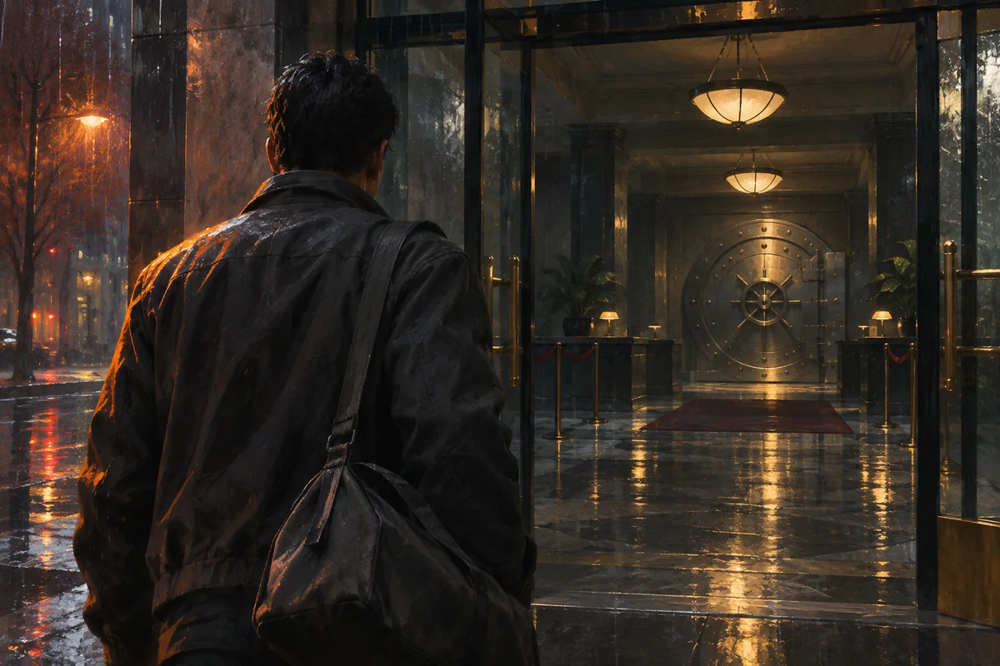

Jason Duval gets a rent-free place to live in *Grand Theft Auto VI*. The catch is that he owes the man who owns it a few favors. That arrangement shows how much Jason has to give up for a fresh start. When a score goes sideways, he and Lucia Caminos find themselves in a criminal conspiracy that reaches across the state, with little choice but to count on each other.

**Jason and Lucia are GTA 6’s two playable leads.** Rockstar’s character guide also introduces seven supporting characters, including both members of the rap duo Real Dimez. Here’s where all nine fit, based on the setup Rockstar has revealed. You can read it before playing the first mission.

If you’re picking up the game, see [what changes between the PS5 and Xbox versions](/gta-6-ps5-pro-60-fps/). If you’re waiting to play on a computer, our [GTA 6 PC requirements guide](/gta-6-system-requirements/) tracks what Rockstar has confirmed and what remains an estimate.

The cover is official Rockstar Games art. The illustrations below are AI-generated editorial scenes inspired by each character’s role.

## Jason Duval has a roof over his head and a reason to leave

Jason grew up around hustlers, served in the Army, and wound up working for drug runners in the Keys. Brian Heder lets him stay at one of his properties in exchange for help with local shakedowns. It’s a familiar line of work for someone who would rather have an easier life.

Jason enters the story with a measure of security that depends on staying useful to Brian. Between that arrangement and the prospect of a life with Lucia, you can see why the aftermath of one bad score feels personal.

## Lucia Caminos has her own plans

Lucia’s father taught her to fight. Standing up for her family landed her in Leonida Penitentiary. When she gets out, she’s determined to build the kind of life her mom dreamed of back in Liberty City. She sees a future with Jason and is willing to take risks to get there.

For Lucia, freedom comes with a decision about what to do next. She has a clear idea of what she wants, and her relationship with Jason matters because it gives them both a stake in those decisions.

## Brian Heder knows how the Keys work

Brian has roots in the Keys’ smuggling heyday and still runs drugs through his boatyard with his wife, Lori. His experience and connections allow him to hand off the jobs that put his associates in harm’s way.

The rent deal makes Brian’s influence easy to understand. He has something Jason needs, and a favor keeps Jason close whenever another job comes up. A boatyard and a spare house tell you more about his standing in the Keys than a flashy introduction could.

## Cal Hampton can find a conspiracy from his living room

Cal is Jason’s friend and another Brian Heder associate. He likes listening in on Coast Guard communications and has enough suspicions to wonder what birds are up to when they fly in formation.

Cal gives the Keys a funny, familiar face. He and Jason know the same people, but Cal is content to spend another evening by the radio. Seeing how comfortable he is helps explain how restless Jason has become.

## Raul Bautista makes every score a bigger gamble

Raul is a veteran bank robber who looks for people willing to take a big risk for a big payout. Rockstar describes him as charming and sharp, with a reckless streak that raises the stakes of each job.

You can see the tension baked into the way he works. The experience that makes him sound worth trusting is part of what makes it tempting to go along with his next gamble.

## Boobie Ike owns a piece of Vice City’s nightlife

Boobie turned money from the streets into a portfolio that includes real estate, a strip club, and a recording studio. He and Dre’Quan Priest are partners in Only Raw Records, and their label could use a hit.

If you’ve heard [how GTA 6’s radio stations give Leonida its sound](/gta-6-vice-city-radio/), Boobie helps you picture the business behind the local music scene. His club gives artists a place to get heard. The studio gives him a way to make money when the song leaves the room.

## Dre’Quan Priest is betting on Real Dimez

Dre’Quan was dealing drugs while pursuing a career in music. He booked acts for Boobie’s club, and now he’s signed Real Dimez to their label. The duo gives him a shot at turning years of knowing what works in the club into a business that reaches a wider audience.

That move gives Vice City’s music scene something to follow from the inside. Dre’Quan’s career is riding on whether the people he signs can make a song that listeners want to hear again.

## Bae-Luxe puts her history into the music

Bae-Luxe and Roxy Rashad have been friends since high school. Together they turned their street experiences into rap tracks and built a following online. An early single with local rapper DWNPLY gave the duo its first taste of a hit.

Bae-Luxe has a stake in what happens when that shared history becomes material for a new record. Real Dimez already has an audience. The question now is how far the music can carry them.

## Roxy Rashad has to keep the audience coming back

As the other half of Real Dimez, Roxy shares Bae-Luxe’s history and the push to grow the duo’s reach on social media. Signing to Only Raw Records puts the two friends back in a position to build on their early success.

Roxy’s story points to the problem facing everyone invested in the label. Getting someone to stop scrolling for a clip is one thing. Getting them to look up the next track is where the duo can turn an early hit into a career.

## Sources

- [Rockstar Games’ GTA 6 launch announcement and story premise](https://www.rockstargames.com/newswire/article/39akk424a9oo53/grand-theft-auto-vi-now-available)
- [Rockstar Games’ profiles of the characters in Leonida](https://www.rockstargames.com/VI/only-in-leonida)
- [Official GTA 6 cast credits](https://www.rockstargames.com/VI/credits)
- [Rockstar Games’ official artwork gallery](https://www.rockstargames.com/VI/media/artwork-wallpapers)

## Related Reading

- [How radio and music bring Vice City to life](/gta-6-vice-city-radio/)
- [How GTA 6 performs on PS5 and Xbox](/gta-6-ps5-pro-60-fps/)
- [What we know about GTA 6 on PC](/gta-6-system-requirements/)
