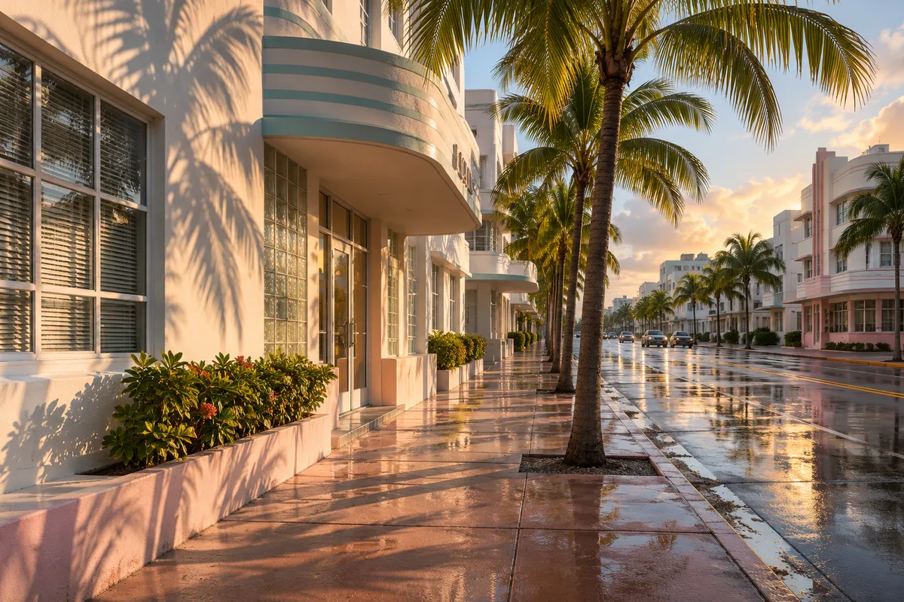
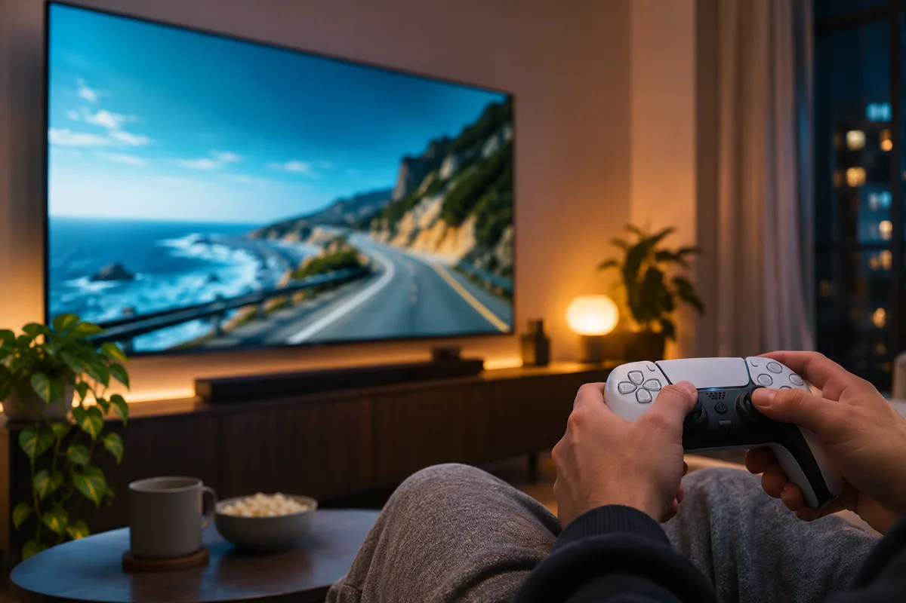

**GTA 6 targets 30 frames per second on PS5 Pro at launch.** At Sony's U.S. list prices, the Pro costs $300 more than the PS5 Digital Edition. That premium buys a sharper-looking version of the game, with Sony's PSSR 2 upscaling and ray-traced shadows specific to the Pro. If you were budgeting for a 60 fps mode, the base console plays the same release with the same frame-rate target.

If the upscaler names look familiar, our [guide to QSSR and PSSR on PS5](/ps5-qssr-ai-upscaling-explained/) explains what those technologies do. And if a PC upgrade is your other option, check [what we know about GTA 6 on PC](/gta-6-system-requirements/) before using rumored specs to plan a build.

## GTA 6 console performance at a glance

Rockstar's technical team outlined the following launch configurations. The base resolution is where the game starts rendering the scene. The reconstructed resolution is the size of the image after upscaling. These figures describe Rockstar's implementation, rather than frame rates taken from a benchmark.

| Console | Base resolution | Reconstructed image | Frame-rate target |
| --- | --- | --- | --- |
| PS5, including the Slim | 1440p | 4K with Rockstar's temporal upscaler | 30 fps |
| PS5 Pro | 1440p | 4K with PSSR 2 | 30 fps |
| Xbox Series X | 1440p | 4K with Rockstar's temporal upscaler | 30 fps |
| Xbox Series S | 720p | 1080p with AMD FSR 4 | 30 fps |

The PS5 Pro and base PS5 start at the same resolution, but they use different techniques to reconstruct detail. The output can look different in motion even when both systems send a 4K picture to a TV. Rockstar also says it composites the interface in 4K across platforms. That means crisp menu text tells you little about the rendering resolution of the scenery behind it.

## Where to look for the PS5 Pro upgrade

Watch the edges of palm fronds, power lines, and fences as the camera pans. Fine details like these are good places to look for differences in how an upscaler handles motion. For the Pro's ray-traced shadows, look at the shape and placement of shadows around street fixtures and vegetation. The game also uses ray-traced global illumination elsewhere in the lineup, with settings tuned to each console. The Series S therefore retains part of the lighting system despite rendering the scene at a lower resolution. [Rockstar's technical interview with Wccftech](https://wccftech.com/grand-theft-auto-vi-amd-fsr-4-xbox-series-s-ray-tracing/amp/).

*AI-generated editorial illustration of street lighting and shadows.*

### Why is there no 40 fps mode at launch?

At 30 fps, the engine gets roughly 33.3 milliseconds between frames. A 40 fps mode cuts that interval to 25 milliseconds, and 60 fps cuts it to 16.7. The console has to update the simulation and render the frame within that tighter budget. Rockstar told TechRadar that it chose 30 fps to balance how much CPU and GPU time would go to simulation, visuals, and gameplay. [TechRadar's interview with Rockstar](https://www.techradar.com/gaming/why-no-40fps-mode-for-gta-6-rockstar-says-the-complexity-of-simulating-and-rendering-our-world-requires-it-to-carefully-balance-how-we-spend-every-millisecond-of-both-the-central-processor-and-the-graphics-processor).

### Will a 120 Hz TV make GTA 6 run faster?

A 120 Hz display can refresh 120 times a second. The console still supplies the frames that the game renders. If the TV receives a 30 fps image, refreshing the panel more often can repeat those frames. For a more responsive feel, try the TV's Game Mode, which usually reduces processing delay. A 4K 60 Hz screen is sufficient to see the reconstructed 4K image from the PS5, PS5 Pro, or Series X.

*AI-generated editorial illustration of a console and TV setup.*

## Is a PS5 Pro worth buying just for GTA 6?

At Sony's U.S. suggested prices, the **PS5 Pro is $899.99**, the **PS5 with a disc drive is $649.99**, and the **PS5 Digital Edition is $599.99**. That puts the Pro **$250 above the disc model** and **$300 above the Digital Edition**, before tax or any promotions. The Pro ships without a disc drive. [PlayStation's U.S. pricing announcement](https://blog.playstation.com/?p=417048).

If you already own a PS5 or Series X and your priority is smoother motion, keep the console you have for this release. If you're buying from scratch and tend to notice softer edges or shadow quality on a large 4K screen, the Pro's picture improvements are the reason to consider paying more. For a smaller screen or a tight budget, put more weight on the total price and the games you already own.

Once you've picked a platform, our [guide to GTA 6's radio stations](/gta-6-vice-city-radio/) offers a spoiler-free way into Vice City. If you're holding out for a native PC release, Rockstar's launch announcement lists PS5 and Xbox Series X|S.

## Sources

- [Rockstar Games, GTA VI launch announcement](https://www.rockstargames.com/VI/out-now)
- [Rockstar Games, frame-rate target and PS5 Pro enhancements](https://www.rockstargames.com/newswire/article/89834o94713o21/pre-load-grand-theft-auto-vi-now)
- [Wccftech, Rockstar's technical breakdown by console](https://wccftech.com/grand-theft-auto-vi-amd-fsr-4-xbox-series-s-ray-tracing/amp/)
- [TechRadar, Rockstar interview on the frame-rate decision](https://www.techradar.com/gaming/why-no-40fps-mode-for-gta-6-rockstar-says-the-complexity-of-simulating-and-rendering-our-world-requires-it-to-carefully-balance-how-we-spend-every-millisecond-of-both-the-central-processor-and-the-graphics-processor)

## Related Reading

- [PS5 QSSR explained](/ps5-qssr-ai-upscaling-explained/)
- [GTA 6 PC system requirements and what remains unknown](/gta-6-system-requirements/)
- [How GTA 6 radio brings Vice City to life](/gta-6-vice-city-radio/)
- [Meet the main and supporting characters of GTA 6](/gta-6-characters/)
