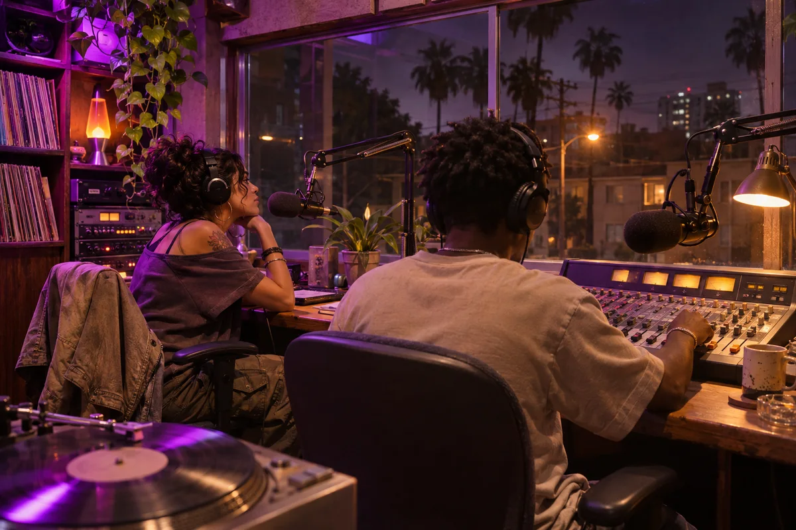
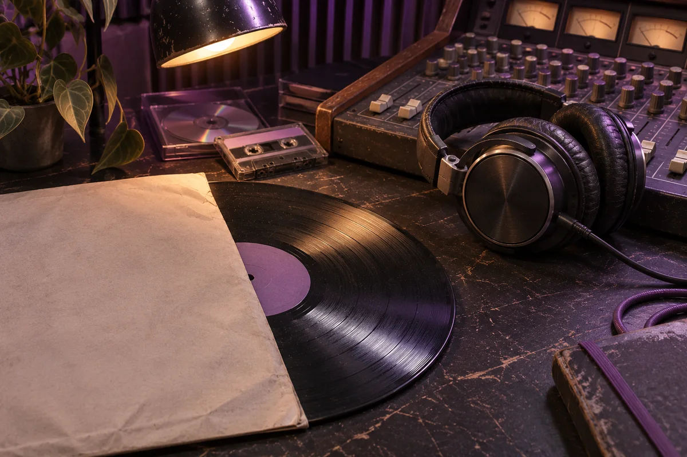
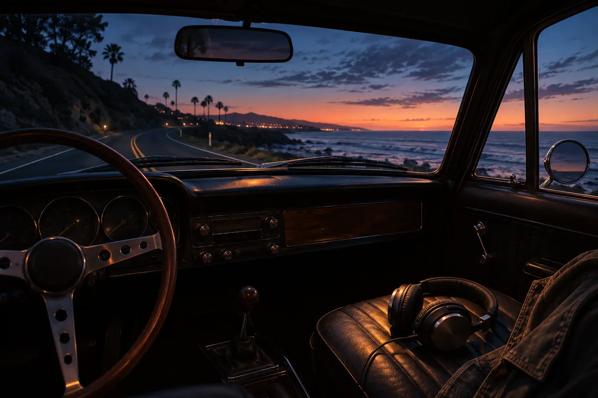

Play two of the GTA 6 radio previews back to back. The first, Cocoteo, puts you in the hands of two DJs playing modern Latin music. The second, Back Country, has the name and country lineup of a station you could imagine finding well outside the city. You can get a feel for the distance between those places before you see a single road.

Rockstar is bringing Grand Theft Auto VI to PS5 and Xbox Series X|S on **November 19, 2026**. For PC players, [the current state of GTA 6's PC requirements](/gta-6-system-requirements/) is a separate question from what Rockstar has confirmed for its console launch. There's also plenty of attention on how games look this generation, as our [guide to PS5 upscaling](/ps5-qssr-ai-upscaling-explained/) explains. GTA 6's sound offers an early look at the game that anyone can try with a pair of headphones.

## Six Stations, Six Ways to Picture Leonida

Flash FM is a recognizable name to anyone who spent time in the original Vice City. In GTA 6, Robyn and Alex host the pop station. Keeping the name gives returning players something familiar to dial in while the voices and the music belong to the new setting. It's the difference between revisiting the record that used to be in your car and finding out a station you loved is still broadcasting.

Cocoteo and Dirty South Classics give that station some company. One leans into contemporary Latin music and the other into classic Southern rap, with Trick and Trina on the mic. Those choices feel more specific to a fictional Florida than a single playlist could. They give two different audiences the chance to hear a station that sounds like somebody programmed it for them.

The rest of the initial lineup breaks up any tidy picture of what Vice City should sound like. Afro Bank FM plays amapiano and other African music, The Chamber is a metal station, and Back Country could make you picture a stretch of Leonida that never appears on a postcard. The stations suggest different communities, even if two listeners are standing at the very same intersection. That's a map of tastes and audiences, where every station has its own idea of who's listening.

## The Radio Comes With You When You Park

[Rockstar's radio announcement](https://www.rockstargames.com/newswire/article/o3982oa93a23k4/the-music-of-grand-theft-auto-vi-in-game-radio-stations) confirms on-demand podcasts as well as terrestrial radio. Jason and Lucia can listen in vehicles and on foot through headphones or earbuds connected to their phones. If you've ever sat in a parked car waiting for a favorite song to finish, you already know the small irritation this feature promises to solve.

There are two listening habits here. A station drops you into whatever the hosts have put on. A podcast is something you choose to start, like picking a voice to keep you company for the walk. Giving players both makes Leonida's media feel closer to the way people actually use it. It also gives Rockstar room to write a personality for an audience that might never hear the station you had on in the car.

If you're [putting together a gaming PC](/best-gaming-pc-ai-and-gaming-2026/) while you wait for PC news, the browser previews give you a way to check out the stations without buying anything. Hit play on one and let it run while you do something else. You start to notice when the DJ pulls your attention back, which is a good indication that you're hearing a station with a personality of its own.

## Radio, Soundtrack, and Score Do Different Jobs

The **in-game radio** is a set of broadcasts inside the fiction, complete with stations and hosts. The **soundtrack album**, *Grand Theft Auto VI: The Album*, is a separate release with 34 original tracks, due alongside the game on November 19. Think of it as an album you can take with you when the console is off.

The **original score**, composed by French electronic duo Justice, responds to how players engage with the world. Its album comes out December 11. You can already hear “Flower in a Hurricane” in the launch trailer and among the music previews. The trailer shows what happens when a song is set against the story for you. In the game, the adaptive score is designed to respond to what you do, while choosing a station is a decision you make yourself.

## Try a Blind Listen Before Launch

Open [Rockstar's music previews](https://www.rockstargames.com/VI/music/flash-fm), pick two stations, and look away from the screen once each clip starts. Give each one enough time to hear both a voice and a bit of music. What time of day do you picture? Who would keep this station on through an entire trip? Is it the energy of the track that tells you, or the way the host talks to the listener?

Try Flash FM and Back Country first, then put Cocoteo next to Afro Bank FM. The second pairing is especially revealing because it can change the city you imagine without sending you to the countryside. You're hearing what a game can do with format, personality, and the songs between the voices. It's an unusually good kind of preview. The station can give you an idea of who lives in Leonida while you still have the pleasure of finding the place yourself.

## Sources

- [Rockstar Games official GTA VI page and release platforms](https://www.rockstargames.com/VI)
- [Rockstar Games announcement of the radio stations and podcasts](https://www.rockstargames.com/newswire/article/o3982oa93a23k4/the-music-of-grand-theft-auto-vi-in-game-radio-stations)
- [Rockstar Games announcement of the Justice original score](https://www.rockstargames.com/newswire/article/39ak8a12395591/grand-theft-auto-vi-original-score-by-justice)
- [Rockstar Games announcement of the official soundtrack album](https://www.rockstargames.com/newswire/article/7599a881942544/announcing-grand-theft-auto-vi-the-album-coming-november-19)

## Related Reading

- [What we know about GTA 6 on PC](/gta-6-system-requirements/)
- [How PS5 upscaling works](/ps5-qssr-ai-upscaling-explained/)
- [How to choose a gaming PC in 2026](/best-gaming-pc-ai-and-gaming-2026/)
