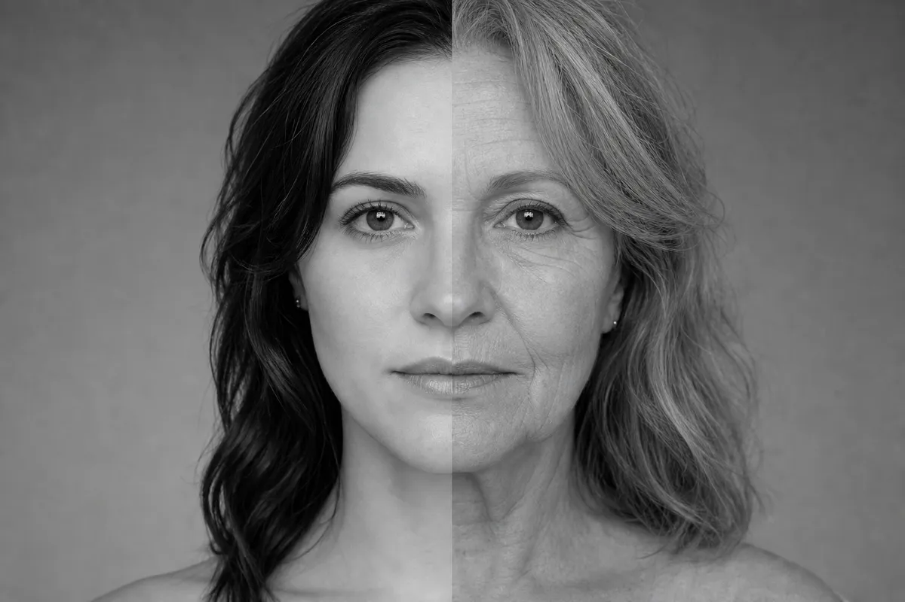
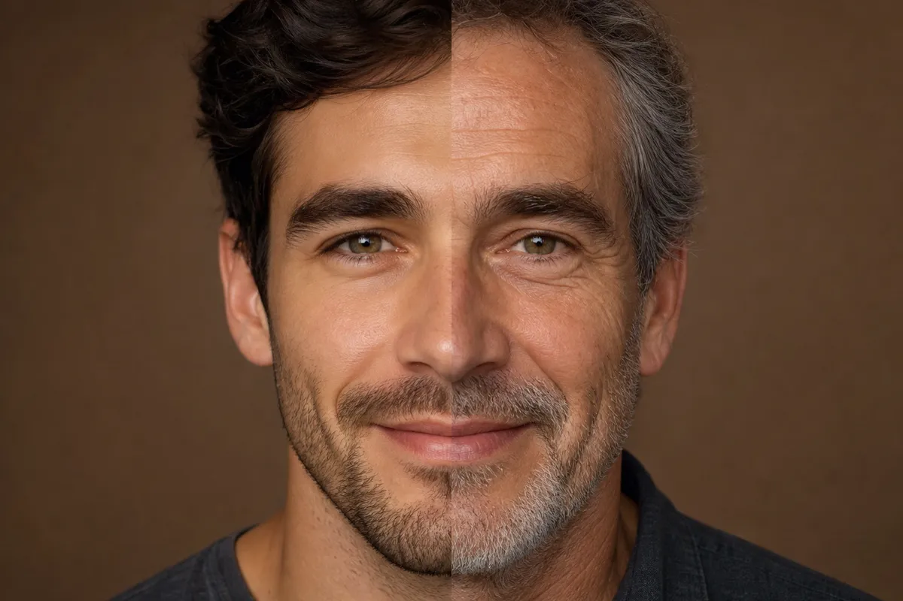
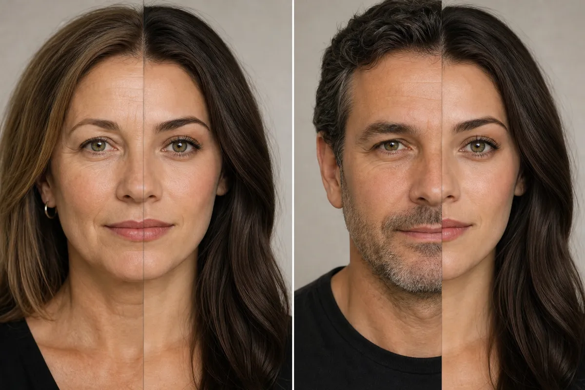

The **split-face AI family trend** answers a question every family argues about: who do you actually look like? You upload a photo of yourself and one of a parent, and the AI builds a single portrait with half of each face joined down the middle.

It looks simple, but it is one of the pickier image prompts out there. Two real faces, two different photos, and tools that are cautious around real people. Below are the exact prompts for ChatGPT and Gemini, how to prepare your photos, the variations worth trying, and the privacy rules to settle before you upload anything.

## What the Split-Face Trend Is (and Why People Do It)

The format is a portrait divided along a vertical center line. The left half is one person, the right half is another, and both stay recognizable. It is usually captioned along the lines of "Mom or Dad?" and posted so friends can vote on which resemblance is stronger.

Tool vendors describe it as a family look-alike trend that has been circulating on TikTok since late summer 2026, and the search terms around it are popular enough that several AI-image sites now publish guides for it. Those guides come from companies selling image tools and give no hard numbers, so treat "viral" as "popular and circulating" rather than a measured fact.

The appeal is easy to see. It is personal, it takes under a minute, and the result is instantly shareable. If you enjoyed the [3D figurine AI trend on ChatGPT](/3d-figurine-ai-trend-chatgpt/) or the [90s AI photo trend](/90s-ai-photo-trend-gemini-prompt/), this is the same idea with a family twist.

## Before You Start: Pick the Right Photos

Most failed attempts come from mismatched inputs, not bad prompts. The two halves end up with different lighting, different sizes or a seam that looks like a collage. Fix that before you open the app:

- **Use two photos, not a description.** Text alone makes the AI invent faces. Upload both photos so it works from real references.
- **Face the camera.** Straight-on, neutral or soft expressions blend far better than tilted heads or big laughs.
- **Match the light.** Two daylight shots, or two indoor shots, will merge more cleanly than one of each.
- **Match the crop.** Frame both from the shoulders up, with the face filling a similar share of the frame.
- **Keep it clean and sharp.** No sunglasses, heavy filters or hats, and skip screenshots.

## The Exact Split-Face Prompt for ChatGPT

ChatGPT is generally stricter than Gemini with real faces, so this version leads with the layout and treats the faces as references to carry over, the same scene-first approach that works for the other trends.

**Attach both photos (yours first, then your family member's), then paste this:**

```text
Using the two attached photos, create one square portrait with a clean vertical split down the center. Left half: the face of the person in the first photo. Right half: the face of the person in the second photo. Keep both people's faces, features and skin tones exactly as in their photos so each is clearly recognizable. Align the eyes, nose and mouth along the center line so the two halves read as one continuous face. Use the same soft, even studio lighting on both sides, with a plain [neutral gray / warm beige] background and matching head size and angle. Style: natural photograph, [black and white / color], subtle film grain. Leave the center seam slightly visible and straight. Avoid: logos, text, watermarks, extra people, heavy retouching, smoothed skin.
```

✅ Naming the layout first (square, vertical split, left and right) gives ChatGPT a task to complete instead of a face to scrutinize  
✅ "Keep both people's faces exactly as in their photos" works better than describing eyes, nose or hair again  
❌ Skip words like "photorealistic deepfake" or "swap faces." Say "split portrait" or "side-by-side blend" instead



*AI-generated example (fictional person, text-to-image). Results from your own photo will differ.*

## The Exact Split-Face Prompt for Gemini

Gemini's image editing handles multi-photo prompts well, so you can ask for a bit more control over the details.

**Attach both photos, then paste this:**

```text
Combine the two attached photos into a single split-face portrait. Layout: a vertical split exactly down the center of the face. Left side: [your name or "me"], from the first photo. Right side: [your mom / dad / sibling / grandparent], from the second photo. Preserve each person's real facial features, hair, skin tone and age. Match head angle, scale and eye line so the halves align. Lighting: soft, even, front-facing light on both halves. Background: plain [color] studio backdrop. Format: [square 1:1 / vertical 4:5]. Mood: calm, neutral expression, looking at the camera. Camera quality: sharp focus, natural skin texture, light film grain. Avoid: text, logos, watermarks, cartoon styling, plastic skin, extra faces.
```

✅ Labeling each side (left, right) and who it belongs to stops Gemini from swapping the halves  
✅ "Preserve each person's real age" keeps a parent from being quietly de-aged to match you  
❌ If one photo is low quality, add one line such as "the second photo is an older print, keep its grain" instead of asking Gemini to "enhance" it



*AI-generated example (fictional person, text-to-image). Results from your own photo will differ.*

## Tips to Make the Result Look Natural

- **Run it twice.** Even with identical wording, outputs vary. The second attempt often fixes a crooked seam.
- **Try black and white.** Removing color hides lighting and skin-tone mismatches, which is why many versions of this trend are monochrome.
- **Ask for a straight, slightly visible seam.** A perfectly invisible blend often looks uncanny. An honest center line looks intentional.

For more phrasing ideas that carry over to other image tasks, see our list of [100 ChatGPT image prompts](/chatgpt-image-prompts-visual-commands/), and compare tools in our [best AI image generators of 2026](/best-ai-image-generators-2026/).

## Variations Worth Trying

Swap a few fields in either prompt and you get a different take on the same format:

- **Mom or dad:** Make two versions and post them as a "vote" carousel. Keep the background and lighting identical so the only difference is the parent.
- **Siblings:** Left half one sibling, right half the other. Add "keep both adult faces at the same age" if one photo is old.
- **Grandparent:** Ask for "a vintage black-and-white treatment" so an older photo and a modern selfie look like they belong together.
- **Three generations:** Use three photos and ask for "a triple vertical split: grandparent, parent, me."
- **You and your own younger self:** Use a current photo and an old one of yourself for a "then and now" split.
- **Pet and owner:** Left half the owner, right half the pet, with "keep the pet's real fur color and markings." This one is lighthearted and tends to get through filters easily.
- **Couple "meet in the middle":** Two adults who both agreed to take part, one photo each, blended along the center line as a playful "our future blend" portrait.

A note on "you and your kid": only use this if you are the adult in the photo and the image is of you. Do not upload photos of children (see the next section).



*AI-generated example (fictional person, text-to-image). Results from your own photo will differ.*

## Avoiding Refusals

The tools are cautious with real faces, and they are more cautious with family photos than with generic selfies. A few habits help:

1. **Describe the layout, not the face.** "Split portrait, left half person one, right half person two" gets further than detailed descriptions of anyone's features.
2. **Use neutral wording.** "Blend" and "combine" tend to work better than "swap" or "replace."
3. **Stay with adults and your own photos.** Image tools often refuse photos that appear to show minors, and you should not be uploading them anyway.
4. **Avoid public figures.** Celebrities and politicians are a fast route to a refusal.

## Privacy and Safety: Read This First

Face photos are sensitive data, and this trend asks you to upload two of them. A few ground rules:

- **Use only your own photos and photos of relatives who have said yes.** Ask before uploading, and ask again before posting. Some people simply do not want their face in an AI tool.
- **Never use photos of minors.** That includes nieces, nephews, grandkids and your friends' kids. Do not upload them and do not post results that show them.
- **Never use photos of people who have not agreed.** That means exes, coworkers, neighbors and strangers.
- **Know where your photos go.** Uploaded images are processed by the service you use, and what happens next depends on that company's settings and policy. Check whether the app keeps your uploads, uses them to improve its models, and how to delete them. Our guide to [protecting your data from AI chatbots](/how-to-protect-your-data-from-ai-chatbots/) walks through the settings to look for.
- **Strip the extras.** Crop out house numbers, license plates and anything that shows where a relative lives or works.
- **Post with intention.** A public post combining two real faces is easy for anyone to copy and reuse. If you share one, consider a private story or a close-friends list instead, and be aware that AI-generated blends of real faces are exactly the kind of image that is hard to tell from manipulated media. If you want to understand how to spot that, see our [deepfake detection guide](/how-to-detect-deepfakes-guide/).

## FAQ

**Which tool is better for the split-face trend, ChatGPT or Gemini?**

_Neither is clearly better every time. Gemini tends to be more flexible with multi-photo prompts, while ChatGPT often needs more careful, layout-first wording. Try the same two photos in both and keep the cleaner result._

**Why is the seam crooked or one side bigger?**

_Usually the source photos differ in angle, crop or distance. Re-crop both to the same framing, then ask for "same head size, eyes aligned on the same horizontal line."_

**Is it okay to use a photo of my child?**

_We recommend against it. Do not upload photos of minors to AI tools, and do not post blended images of them. Use adult family members who have agreed._

## Sources

- [Miraflow: AI family look-alike prompts and the mom/dad trend](https://miraflow.ai/blog/ai-family-look-alike-prompts-mom-dad-trend-2026)
- [Dreamina: Look Like Your Mom or Dad trend](https://dreamina.capcut.com/ai-image/look-like-your-mom-or-dad-trend)

## Related Reading

- [The 3D Figurine AI Trend on ChatGPT: The Exact Prompt That Works](/3d-figurine-ai-trend-chatgpt/)
- [90s AI Photo Trend: Exact Prompts for Gemini and ChatGPT](/90s-ai-photo-trend-gemini-prompt/)
- [100 ChatGPT Image Prompts I Actually Use Instead of Generic AI Photos](/chatgpt-image-prompts-visual-commands/)
- [How to Protect Your Data From AI Chatbots (2026 Guide)](/how-to-protect-your-data-from-ai-chatbots/)
- [How to Detect Deepfakes in 2026: 12 Checks and 6 Free Tools That Work](/how-to-detect-deepfakes-guide/)
